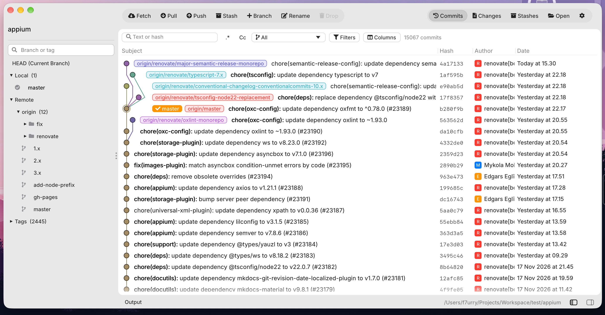

# TailGIT

A fast, native desktop Git client written in Rust with [egui](https://github.com/emilk/egui).



TailGIT brings IntelliJ IDEA's Git tool window (`plugins/git4idea` and `platform/vcs-log`
in IntelliJ Community) to a standalone app with a macOS-style interface. Every operation
runs the `git` CLI, just as git4idea does, so your hooks, credential helpers, SSH config
and `.gitconfig` behave exactly as they do in the terminal.

## Highlights

- **Commit log** with an IntelliJ-style graph, ref labels, filters and 50,000 commits per page.
- **Branch sidebar** with local, remote and tag trees, favorites and ahead/behind counts.
- **Staging area** that stages single change blocks or single lines.
- **Three-way merge window** for resolving conflicts, modeled on IntelliJ's.
- **Everyday Git** in one toolbar: fetch, pull, push, stash, branch, rename and drop.

## Getting started

You need a Rust toolchain and `git` on your `PATH`.

```bash
cargo run --release -p tailgit-app -- /path/to/repo
```

The path is optional. Without it, TailGIT opens a welcome screen where you can pick a
folder, type a path, or reopen a recent repository.

To build a macOS app bundle, run:

```bash
scripts/bundle-macos.sh
```

The script builds `TailGIT.app` with its icon, signs it ad hoc, and installs it to
`~/Applications`, replacing any earlier copy.

## Features

### Toolbar

The left group holds the Git actions: **Fetch**, **Pull** (merge, rebase or fast-forward
only), **Push**, **Stash**, **Branch**, **Rename** and **Drop**. Pull and Push show how many
commits are waiting. The right group switches between the **Commits**, **Changes** and
**Stashes** views and holds **Open** (folder picker and recent repositories) and Settings.

### Commit log

- Commit graph with per-lane colors. Long edges are shortened to arrows at both ends.
- Branch and tag labels can sit above, below, left or right of the subject, in their own
  column, or be hidden. Styles: colorful, accent color, or border only.
- Columns: Subject, Branches, Author, Hash and Date. Drag a header to reorder, drag a
  divider to resize, and toggle Author, Hash and Date from **Columns**. The layout is saved.
- Search by text or hash, with regex (`.*`) and match case (`Cc`). Pick a branch, and open
  **Filters** for author, date range, paths and "Hide merge commits".
- Sort by date or topologically.
- Loads 50,000 commits at a time. **Load more** fetches the next page.
- Keyboard navigation (arrows, Page Up/Down, Home/End, Cmd+A) and multi-select.
- Context menu: copy hash or subject, checkout revision, new branch, new tag, cherry-pick,
  revert, drop commit (with **Undo** in the status bar), reset the current branch to here,
  rebase onto here, and merge. Most actions also work on several selected commits.

### Branches

- Sidebar tree with HEAD, Local, Remote (one group per remote) and Tags. Names are split
  into folders on `/`.
- The current branch and favorites come first, and each branch shows ahead/behind counts.
  Search by branch or tag name.
- Context menu: checkout, new branch, rebase onto, merge, reset, set or unset upstream,
  rename, delete (local and remote), and push tag.

### Commit details and diffs

- Changed files, full message, parents, refs and the branches that contain the commit.
- Unified or side-by-side diffs, with adjustable font size and optional `-`/`+` marks.

### Changes and staging

- Staged, Changes, Unversioned and Conflicts lists, with stage, unstage, rollback, amend,
  commit, and commit and push.
- In the unified diff, each change block has **Stage**, **Unstage** and **Rollback**, and
  single lines can be selected and staged on their own.
- Partial staging writes the new index content directly (`hash-object` + `update-index`),
  so no patch has to apply. A selection made on outdated contents is refused.

### Sync

Fetch, pull, and a push dialog with upstream, force-with-lease and tags options. Command
output streams into the **Output** panel at the bottom of the window.

### Stash

Create a stash (optionally including untracked files or keeping the index), then apply it
(with or without restoring the index), pop, drop, or unstash it as a branch. Each stash's
changed files can be browsed.

### Conflict resolution

Built after IntelliJ's `MultipleFileMergeDialog` and three-way merge viewer.

- A banner appears while a merge, rebase, cherry-pick or revert is in progress, with
  **Resolve…**, **Continue** and **Abort**.
- The **Conflicts** dialog says what is being merged ("Merging branch **feature** into
  branch **main**", or the rebase, cherry-pick or revert being applied). It lists files as
  Name | Yours | Theirs, marks each side Modified or Deleted, and can group by directory.
  - Click, Shift-click and Cmd-click select files. **Accept Yours**, **Accept Theirs** and
    **Merge…** (Enter or double-click) act on the selection.
  - The dialog closes once nothing is unmerged. After a rebase it offers **Continue Rebase**;
    after a cherry-pick or revert it opens the Changes view with the original message.
- The **merge window** opens in its own native window as left (yours) | Result | right
  (theirs), with IntelliJ's titles such as "Changes from main" or "Rebasing abc123 from
  feature".
  - The result starts as the base text. Each change has `≫`/`≪` to accept it and `×` to
    ignore it. Accepting the second side of a conflict appends it, Ctrl- or Cmd-click
    resolves a conflict in one step, and conflicts that can be merged automatically get
    `✨ Resolve`.
  - The toolbar has "Apply non-conflicting changes: Left / All / Right", Resolve Simple
    Conflicts, Revert Conflict Resolution, next/previous difference, and an "Automatically
    apply non-conflicting changes" option (off by default).
  - The result is editable and syntax-highlighted. Finish with **Accept Left**, **Accept
    Right**, **Save and Close** (save without marking the file resolved) or **Apply
    Changes**. Closing the window asks before discarding changes.
- Yours and theirs are swapped during a rebase. Conflict markers are detected with
  IntelliJ's rule, and an incomplete base that contains markers is replaced by the
  merge-base version.

### Interface

- Light, dark, or follow the system.
- Interface font: Inter (bundled), the system font, or any installed family, with
  adjustable size, hinting and sub-pixel positioning.
- Toggle the sidebar and details pane from the status bar.
- Native macOS menu bar. Settings open with **Cmd+,**.
- Reloads automatically when anything under `.git` changes and when the window gets focus.

## Configuration

Preferences, recent repositories, favorite branches and the log column layout are stored in
`settings.json`:

| OS | Path |
|---|---|
| macOS | `~/Library/Application Support/dev.tailgit.tailgit/settings.json` |
| Linux | `~/.config/tailgit/settings.json` |
| Windows | `%APPDATA%\tailgit\tailgit\config\settings.json` |

TailGIT never prompts for credentials. Fetch, pull and push rely on your Git credential
helper or ssh-agent.

## Project layout

| Crate | Purpose | Ported from (IntelliJ) |
|---|---|---|
| [`crates/git-core`](crates/git-core) | Runs `git` and parses log, refs, status and stash output; write operations; conflict loading; diff3 and the three-way merge model; partial staging | `GitHandler`, `GitLogParser`, `GitRepositoryReader`, `GitIndexStatusUtil`, `GitImpl`, `GitMergeUtil`, `MergeConflictModel` |
| [`crates/log-graph`](crates/log-graph) | Commit graph layout: layout-index DFS, per-row lanes, long-edge arrows, lane colors | `GraphLayoutBuilder`, `PrintElementGeneratorImpl`, `GraphColorManagerImpl` |
| [`crates/tailgit-app`](crates/tailgit-app) | The egui application (`tailgit` binary) | Git Log, Commit and Stash tool windows |

Git commands run on background threads and report back to the UI, so the window stays
responsive during long operations.

## Development

```bash
cargo test --workspace
```

## License

Apache-2.0. The bundled Inter font is licensed under the SIL Open Font License
([`crates/tailgit-app/assets/Inter-OFL.txt`](crates/tailgit-app/assets/Inter-OFL.txt)).
